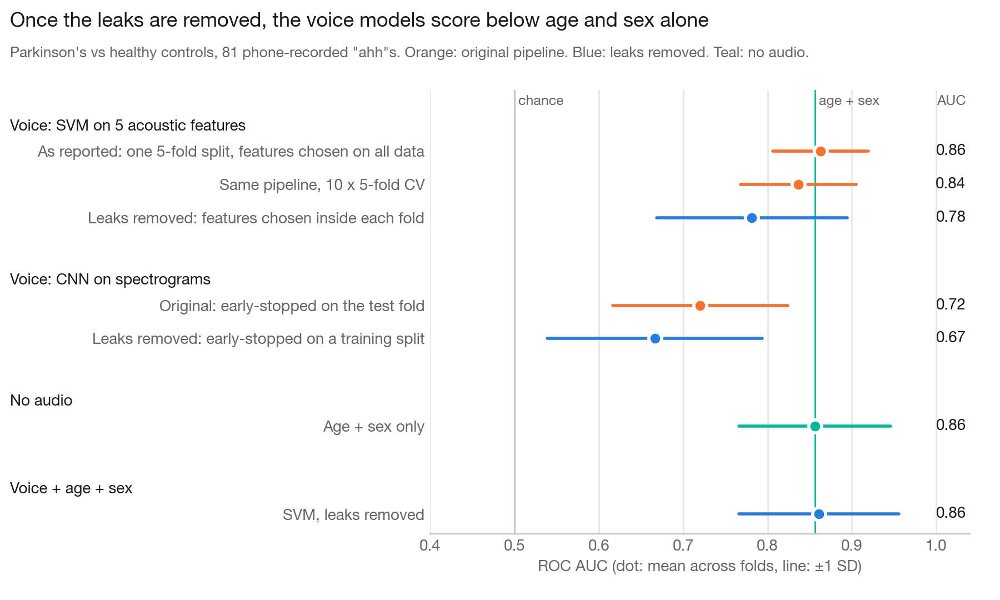
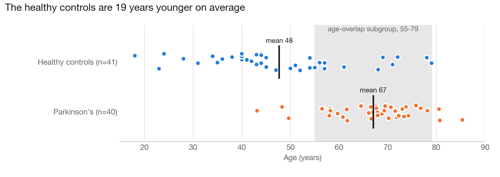
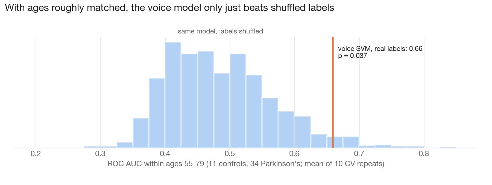

# parkinson-disease

> Can a short "ahh", recorded over the phone, tell whether someone has Parkinson's?

**Short answer: not with this data.** My first result looked good (82.7% accuracy), but it came
from a mistake in how I tested the model. Fixed, it drops to 71.6%. And in this dataset, a person's
age predicts Parkinson's better than their voice does.

<picture>
  <source media="(prefers-color-scheme: dark)" srcset="assets/01_auc_by_model_dark.png">
  
</picture>

[](https://colab.research.google.com/github/cortezxm/parkinson-disease/blob/main/parkinson_detection.ipynb)

## The story

**The question.** Parkinson's often changes the voice before it is diagnosed. If a model can hear
that change in a three-second "ahh" recorded over the phone, screening would be cheap and could be
done from home.

**What I first reported.** My first version of this project said a simple model
(an SVM, a classic machine-learning model) on five voice measurements found 85% of the people with
Parkinson's, with 82.7% accuracy. A deep-learning model (a CNN) did worse.

**What I found when I checked my own work.** Two things made that result look better than it was.

1. **The model got a peek at the answers.** I picked the five voice measurements, and later the
   decision threshold, by looking at all 81 recordings, including the ones the model was later tested
   on. That is like writing an exam after seeing the answer key, and it is called a *data leak*.
   When those choices are made using
   only the training data, accuracy drops from 82.7% to **71.6%**. The CNN had the same kind of
   problem: it chose when to stop training by looking at its test data. Fixed, it reaches only
   **60.0%**.
2. **The model may be hearing age, not Parkinson's.** In this dataset the healthy volunteers are, on
   average, **19 years younger** than the people with Parkinson's. A model that knows only each
   person's age and sex, with no audio at all, gets **81.8%** accuracy. That is better than any of
   the voice models. Adding the voice on top of age and sex adds nothing measurable.

**Is there any voice signal at all?** Maybe a small one. When I keep only people aged 55 to 79, so
both groups have similar ages, the voice model still does a little better than chance. If the voice
carried no signal at all, a score this high would show up by luck about 4 times in 100
(p = 0.037). But that group has only 11 healthy people, so this is a hint, not proof.

**Why it matters.** With small medical datasets, a score can look great because of how it was
measured, not because the model learned anything about the disease. Here the honest answer to
"can an 'ahh' reveal Parkinson's?" is: **this data cannot tell**, because the voice is mixed up with
age.

---

## The three charts

**How to read the scores.** Most numbers below are the **AUC**, a score from 0.5 to 1.0 for how well
a model separates the two groups. 0.5 is a coin flip and 1.0 is perfect. Every model was tested 50
times on different splits of the data. The dot is the average of those 50 tests, and the line shows
how much the score moved between them (±1 standard deviation).

### 1. Without the peeking, the voice models score below age and sex alone

<picture>
  <source media="(prefers-color-scheme: dark)" srcset="assets/01_auc_by_model_dark.png">
  
</picture>

Orange is the original method and blue is the same model with the leaks removed. The teal line is
what age and sex alone achieve, with no audio.

### 2. The two groups have very different ages

<picture>
  <source media="(prefers-color-scheme: dark)" srcset="assets/02_age_by_group_dark.png">
  
</picture>

Only 7 of the 41 healthy volunteers are 60 or older, against 31 of the 40 people with Parkinson's.
Voices change with age, so this difference alone can make a voice model look like it detects
Parkinson's.

### 3. With ages matched, the voice signal is weak

<picture>
  <source media="(prefers-color-scheme: dark)" srcset="assets/03_subgroup_permutation_dark.png">
  
</picture>

The bars show the scores of the same model trained 1,000 times on shuffled labels, where nothing
real can be learned. The orange line is the score with the real labels. It sits at the edge of the
shuffled scores (p = 0.037).

---

## Numbers you can check

Every number comes from `parkinson_detection.ipynb` and is saved in
[`results/summary.json`](results/summary.json). Unless noted, each row is the average over the same
50 tests (5-fold cross-validation, repeated 10 times).

| Model | Accuracy | AUC | Finds Parkinson's (sensitivity) | Clears healthy people (specificity) |
|---|---|---|---|---|
| SVM, as first reported (one 5-fold split) | 82.7% | 0.86 | 85.0% | 80.6% |
| SVM, same method, 50 tests | 77.1% | 0.84 | 78.5% | 75.6% |
| **SVM, leaks removed** | **71.6%** | **0.78** | **68.0%** | **75.1%** |
| CNN, as first built (stops training by looking at the test data) | 63.0% | 0.72 | 58.8% | 67.3% |
| **CNN, leaks removed** | **60.0%** | **0.67** | **52.8%** | **67.1%** |
| **Age + sex only, no audio** | **81.8%** | **0.86** | **80.8%** | **82.8%** |
| Voice + age + sex | 78.6% | 0.86 | 79.0% | 78.2% |

- **Voice over age and sex:** adding the voice moves the AUC by +0.001, and it helps in only 24 of
  the 50 tests.
- **Ages 55 to 79 (11 healthy, 34 Parkinson's):** the voice model scores AUC 0.66. Age and sex score
  0.32 there, so age no longer helps. With shuffled labels the model averages 0.49, which gives
  p = 0.037.
- **Rerunning the original method exactly** reproduces the first report: 82.7% accuracy with 5-fold
  CV, and 74.1% with leave-one-out at a threshold of 0.45.
- **Choosing the threshold inside each training set** does not help the leak-free SVM: 69.9%
  accuracy and 68.2% sensitivity.

---

## What this analysis cannot do

Stated up front, because a result is only worth as much as its limits.

- **It cannot separate Parkinson's from age.** The groups differ by 19 years on average. The
  age-matched check uses only 11 healthy people, and I chose the 55–79 range by looking at the ages
  (never at model results). One p-value of 0.037 on one subgroup is weak evidence.
- **The most-used feature may measure the phone, not the voice.** `rms_range`, how much the loudness
  varies, was picked in all 50 tests. On a phone recording, loudness also depends on how far the
  phone is from the mouth and on the phone itself.
- **The SVM settings were not chosen here.** C = 10 and γ = 0.1 come from the original work, and the
  code does not record how they were picked. If they were tuned on all 81 recordings, a small leak
  remains in every SVM row.
- **The data is small and narrow:** 81 people, one dataset, one vowel, 8 kHz phone audio. Nothing was
  tested on an outside dataset. There is no information on disease stage or medication.
- **The ± values show spread between tests, not a confidence interval.** The 50 tests reuse the same
  81 people, so they are not independent.
- **The CNN uses slightly different data augmentation** from my first version. To keep training fast,
  the noisy, stretched and pitch-shifted copies of each recording are made once (five per type)
  instead of fresh every epoch.

---

## The engineering

**Stack.** Python, scikit-learn, PyTorch, librosa and Praat (through `parselmouth`). One notebook
runs top to bottom and writes every number and chart in this README.

**Data.** [Voice Samples for Patients with Parkinson's Disease and Healthy Controls](https://doi.org/10.6084/m9.figshare.23849127)
(Prior, Virmani, Iyer et al., figshare 2023, CC BY 4.0): 81 sustained "ahh" recordings at 8 kHz, plus
each person's age and sex. The recordings are not stored in this repo. The notebook downloads them
from figshare and checks their checksums.

**Run it.** Click **Open in Colab** above, or run it locally:

```bash
git clone https://github.com/cortezxm/parkinson-disease.git && cd parkinson-disease
python3 -m venv .venv && source .venv/bin/activate
pip install -r requirements.txt jupyter
jupyter lab parkinson_detection.ipynb
```

- **Locally**, a full run takes under two minutes on a laptop, including the download. It reuses
  the saved CNN results in `results/cnn_folds.json`. Set `RECOMPUTE_CNN = True` to retrain the
  CNN from scratch, which takes about 5 more minutes on a laptop CPU.
- **In Colab**, the CNN is retrained because the saved results are not there.
- **The numbers repeat exactly** from run to run, because the seed is fixed at 42. Retraining the CNN
  on different hardware or library versions can move its numbers slightly.

**How it's built.**

1. **Download and check** the recordings and the age/sex table.
2. **Extract 91 voice measurements** per recording: pitch, formants, loudness, jitter, shimmer,
   harmonics-to-noise ratio, 13 MFCCs (a standard summary of the shape of the sound) and four
   spectral measures.
3. **Create 50 tests:** split the 81 people into 5 parts, train on 4 and test on 1, rotate, then
   repeat with 10 different shuffles. Every model sees the same 50 splits.
4. **Keep the test part untouched.** Every choice is made inside the training part: which 5
   measurements to use, the decision threshold, and when the CNN stops training.
5. **Run the original method too**, exactly as first reported, so each fix can be measured.
6. **Check for the age confound:** age and sex alone, voice plus age and sex, and the age-matched
   subgroup with a 1,000-shuffle permutation test.

**What's in the repo.**

| Path | What it is |
|---|---|
| `parkinson_detection.ipynb` | The whole analysis, with its outputs saved |
| `results/summary.json` | Every number in this README |
| `results/cnn_folds.json` | Per-test CNN results, so a run does not have to retrain |
| `assets/` | The charts, in light and dark versions |
| `docs/` | The paper (LaTeX source, PDF and figures) |

## Paper

[`docs/early_parkinsons_detection_speech.pdf`](docs/early_parkinsons_detection_speech.pdf) is the
write-up, updated with these corrected results. Its source is `docs/main.tex`.

## Credits

The dataset is by Fred Prior, Tuhin Virmani, Anu Iyer, Linda Larson-Prior, Aaron Kemp, Yasir
Rahmatallah and colleagues at the University of Arkansas for Medical Sciences. Their own analysis is
Iyer et al., *A machine learning method to process voice samples for identification of Parkinson's
disease*, Scientific Reports 13, 20615 (2023), [doi:10.1038/s41598-023-47568-w](https://doi.org/10.1038/s41598-023-47568-w).

Code under the [MIT license](LICENSE). The dataset keeps its own CC BY 4.0 license.
